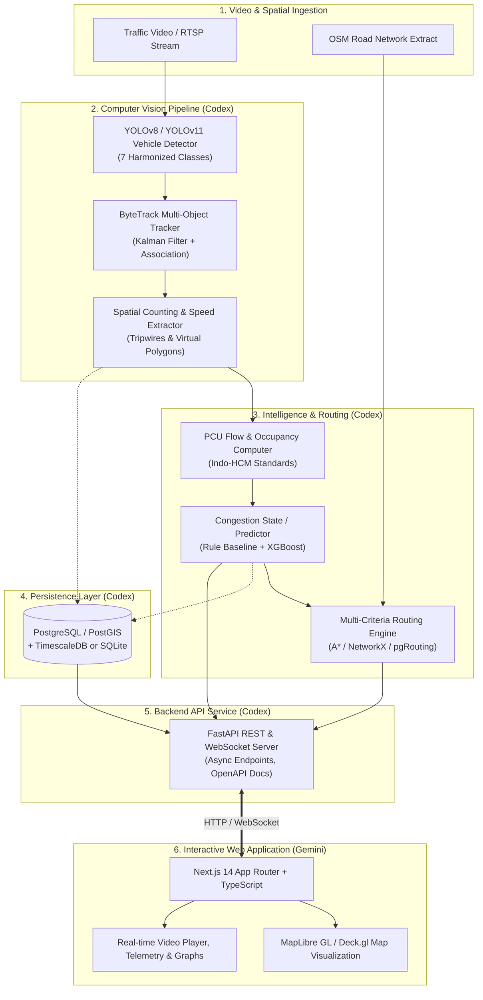

# System Architecture & Technical Specification: VisionSafe AI

## 1. System Overview & Vision

VisionSafe AI is an end-to-end intelligent traffic monitoring, real-time congestion analysis, and multi-criteria route recommendation platform designed specifically for dense, unstructured urban environments typical of Indian cities.

The system processes real-world CCTV/video feeds, performs real-time vehicle detection and multi-object tracking, calculates standardized Passenger Car Unit (PCU) flow and density metrics, forecasts congestion trends, and evaluates alternative candidate routes using a multi-criteria routing engine (balancing travel time, congestion severity, road hierarchy, and incident safety).

---

## 2. End-to-End Vertical Slice

To prove system validity before large-scale model training and full backend deployment, VisionSafe AI defines a **working vertical slice**:

1. **Input Video**: A 60-second 1080p sample video of an Indian urban arterial corridor (e.g. Bangalore Outer Ring Road / junction).
2. **Inference**: YOLOv8/11 detector identifies vehicles (cars, auto-rickshaws, buses, trucks, 2-wheelers).
3. **Tracking**: ByteTrack links detections into continuous object trajectories with unique track IDs, maintaining state across occlusions.
4. **Observation Extraction**: A counting tripwire and region-of-interest (ROI) polygon calculate:
   - Vehicle count by class per minute
   - Total PCU (Passenger Car Unit) flow rate
   - Instantaneous road occupancy ratio (%)
   - Estimated link average traversal speed (km/h)
5. **Congestion Estimation**: Aggregator classifies the corridor into Level of Service (LOS A through F) and congestion index ($0.0 \le C \le 1.0$).
6. **Candidate Route Comparison**: Routing engine compares 2-3 candidate paths connecting the monitored road segment to a destination, computing:
   - Static free-flow time
   - Congestion-adjusted estimated traversal time (ETA)
   - Safety / vulnerability penalty score
7. **Recommendation Engine**: Emits optimal route with justification metrics and renders the annotated video stream alongside real-time route comparisons in the Next.js frontend.

---

## 3. Strict Boundary & Module Ownership Matrix

To eliminate conflicts and allow parallel execution without merge contention, ownership is strictly decoupled:

| Subsystem / Path | Primary Owner | Secondary / Integration | Description |
|---|---|---|---|
| `frontend/` | **Gemini** | - | Next.js 14, TypeScript, Tailwind CSS, MapLibre GL, Video Player, Route Explorer, Telemetry Dashboards. |
| `frontend/src/services/api/` | **Gemini** | Codex (Review) | Client-side API client strictly consuming schemas defined in `docs/API_CONTRACT.md`. |
| `backend/` | **Codex** | - | FastAPI application, database connections, Pydantic models, API route controllers. |
| `backend/pipeline/` | **Codex** | - | Video decoding, YOLO inference wrapper, ByteTrack integration, speed & density estimation. |
| `backend/ml/` | **Codex** | - | Congestion forecasting models, feature engineering, offline training, evaluation scripts. |
| `backend/routing/` | **Codex** | - | Graph-based multi-criteria routing, travel time weighting, candidate path ranking. |
| `data/` | **Codex** | - | Dataset downloads, conversion scripts, cache management, storage validation. |
| `docs/` | **Gemini (Arch)** | Codex (Spec updates)| System specifications, API contracts, storage limits, task board. |

**No-Overlap Rule**: Codex modifies code exclusively in `backend/`, `data/`, `models/`, and backend test directories. Gemini modifies code exclusively in `frontend/`, client integration files, and architectural documentation.

---

## 4. Perception & Intelligence Specifications

### 4.1 Vehicle Detection & Tracking
- **Detector**: Ultralytics YOLOv11n fine-tuned on the standardized 7-class Indian traffic taxonomy.
- **Tracker**: ByteTrack using Kalman filter motion prediction and two-stage Hungarian matching on IoU/re-identification distance.
- **Tripwire & Polygon Metrics**:
  - Virtual counting lines record directional ingress/egress.
  - Spatial occupancy calculated as bounding box ground projection area relative to calibrated road polygon area.

### 4.2 Traffic Congestion Model (PCU-weighted Level of Service)
Congestion index $C \in [0, 1]$ is computed from multi-modal inputs:
$$PCU_{total} = \sum_{k \in Classes} N_k \cdot w_k$$
where $w_k$ is the Indo-HCM weighting factor (2W: 0.5, 3W: 0.8, Car: 1.0, Bus/Truck: 3.0).

Level of Service (LOS) mapped as:
- **LOS A-B (Free Flow)**: $C \in [0.0, 0.3)$
- **LOS C-D (Moderate / Approaching Capacity)**: $C \in [0.3, 0.7)$
- **LOS E-F (Severe Congestion / Gridlock)**: $C \in [0.7, 1.0]$

### 4.3 Candidate Route Evaluation
For path $P = (e_1, e_2, \dots, e_m)$ through road graph $G=(V, E)$:
$$Cost(P) = \sum_{e \in P} \left( \frac{Length(e)}{V_{est}(e)} \cdot \left(1 + \alpha \cdot C(e)^\beta\right) + \gamma \cdot Penalty_{road\_class}(e) \right)$$
Where $V_{est}$ incorporates current vision observations when available or historical fallback when live sensor data is absent.

---

## 5. Data Flow & Separation of Traffic Temporal States

To adhere to data integrity principles, the platform enforces strict data state tagging:

1. **Current Observations (`state: "live_observation"`)**: Real-time measurements generated within the past 120 seconds directly from active CV pipelines.
2. **Historical Measurements (`state: "historical"`)**: Aggregated statistical metrics (hourly/daily averages per link) stored in time-series tables.
3. **Forecasts (`state: "forecast"`)**: Forward-looking predictions (15-60 min horizon) generated by ML models, flagged with confidence bounds.
4. **Third-Party Provider Feeds (`state: "third_party"`)**: External data (e.g. TomTom, Google, OSM public tags).

**Critical Guardrail**: The system will never present static or historical baseline data as live observations. Any missing live feed explicitly renders as `status: "offline"` or `status: "historical_fallback"`.

---

## 6. Technology Stack Justification

1. **Frontend**: Next.js 14 (App Router) + TypeScript + Tailwind CSS. Provides performant SSR/SSG, robust developer typing, and modern responsive UI styling.
2. **Backend**: FastAPI (Python 3.14 compatible). Asynchronous high-throughput ASGI framework with native Pydantic validation and automatic OpenAPI documentation.
3. **Database**: PostgreSQL 16 + PostGIS for spatial queries and road topology, with SQLite/DuckDB fallback for lightweight standalone local execution.
4. **Vision Engine**: Ultralytics YOLO + ByteTrack + OpenCV for performant inference and tracking.
5. **Machine Learning**: Scikit-Learn + XGBoost for tabular congestion prediction and baseline evaluation.
